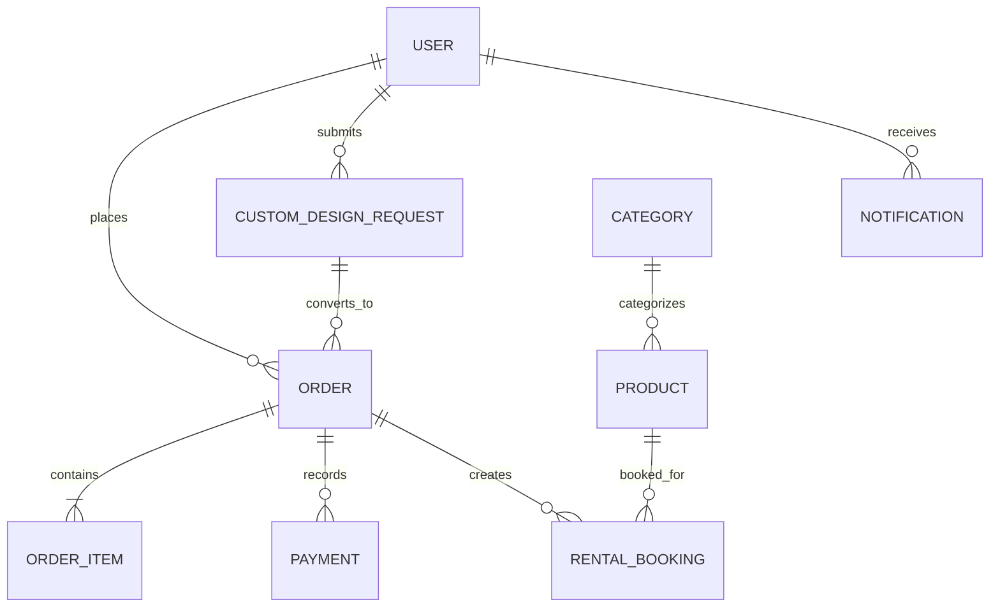

# Lavanya Collections — Database Architecture & Schema Specification

This document details the MongoDB data architecture, entity relationships, schemas, and indexing strategies implemented in Lavanya Collections.

---

## 1. Architecture Overview

- **Database Engine**: MongoDB 6.0+ (MongoDB Atlas compatible)
- **Object Data Modeling (ODM)**: Mongoose v8.9
- **In-Memory Fallback**: `mongodb-memory-server` v10.1 (zero-friction local development)
- **Design Paradigm**: Relational integrity with targeted document embedding for financial snapshots and audit logs.



---

## 2. Entity Schemas & Fields

### 2.1 User (`server/models/User.js`)
Stores authenticated store administrators and customers.

| Field | Type | Required | Unique | Description |
| :--- | :--- | :--- | :--- | :--- |
| `name` | String | Yes | No | Full customer or administrator name |
| `email` | String | Yes | Yes | Normalized lowercase email address |
| `password` | String | Yes | No | bcrypt hashed string (salted with 10 rounds) |
| `phone` | String | No | No | Contact phone number (E.164 or Indian 10-digit) |
| `role` | String | Yes | No | `'customer'` or `'admin'` (default: `'customer'`) |
| `addresses`| Array | No | No | Sub-documents with street, city, state, pincode |
| `isActive` | Boolean| Yes | No | Account status flag (default: `true`) |
| `createdAt`| Date | Auto | No | Account registration timestamp |

---

### 2.2 Category (`server/models/Category.js`)
Organizes products across boutique departments (Jewellery, Photoshoot Frocks, Doll Sets, Wedding Decor, etc.).

| Field | Type | Required | Unique | Description |
| :--- | :--- | :--- | :--- | :--- |
| `name` | String | Yes | Yes | Category title |
| `slug` | String | Yes | Yes | URL-friendly slug (`kebab-case`) |
| `description` | String | No | No | Descriptive summary of the category |
| `imageUrl` | String | No | No | Category banner / thumbnail URL |
| `displayOrder` | Number | No | No | Sorting sequence in navigation and shop page |
| `isActive` | Boolean| Yes | No | Toggles visibility in customer catalog |

---

### 2.3 Product (`server/models/Product.js`)
Represents boutique inventory items available for purchase, rental, or both.

| Field | Type | Default | Description |
| :--- | :--- | :--- | :--- |
| `name` | String | Required | Product display name |
| `slug` | String | Required | Indexed URL slug |
| `description` | String | Required | Full rich-text or formatted product description |
| `category` | ObjectId | Ref: Category | Reference to parent category |
| `price` | Number | Required | Regular purchase price in INR (₹) |
| `salePrice` | Number | Null | Discounted promotional price |
| `stock` | Number | 0 | Available physical stock units |
| `isRentalAvailable` | Boolean | false | Flag indicating whether product can be rented |
| `rentalPrice` | Number | 0 | Daily rental fee in INR (₹) |
| `rentalSecurityDeposit` | Number | 0 | Refundable security deposit for rental |
| `paymentMode` | String | `'both'` | `'advance_only'`, `'full_only'`, or `'both'` |
| `advancePercentage` | Number | 20 | Percentage required if customer chooses advance |
| `images` | Array | `[]` | Array of image URLs / Cloudinary secure paths |
| `specifications` | Map / Object | `{}` | Key-value attributes (Material, Color, Care, Size) |
| `isFeatured` | Boolean | false | Highlights product on storefront landing page |
| `isActive` | Boolean | true | Active product catalog flag |

---

### 2.4 Order & Order Items (`server/models/Order.js`)
Implements an **immutable snapshot pattern** to ensure price or product changes never corrupt historical transactions.

```javascript
// Snapshot embedded in Order.items array:
{
  product: ObjectId,          // Ref to Product
  title: String,              // Snapshotted name at time of order
  price: Number,              // Snapshotted unit price
  quantity: Number,           // Units purchased or rented
  isRental: Boolean,          // Whether this line item was a rental
  rentalDates: {
    startDate: Date,
    endDate: Date,
    totalDays: Number
  },
  selectedPaymentOption: String, // 'full' or 'advance'
  advancePercentage: Number,     // E.g. 20%
  advanceAmount: Number,         // Snapshotted advance required
  balanceAmount: Number          // Snapshotted remaining balance
}
```

#### Order Level Financial Summary:
- `totalAmount`: Sum of all items + taxes + shipping in INR.
- `advancePaid`: Amount paid online during checkout via Razorpay.
- `balanceDue`: Outstanding balance payable upon delivery or pickup.
- `orderStatus`: `'pending_payment'`, `'processing'`, `'shipped'`, `'delivered'`, `'cancelled'`.
- `paymentStatus`: `'unpaid'`, `'advance_paid'`, `'fully_paid'`, `'refunded'`.

---

### 2.5 Rental Booking (`server/models/RentalBooking.js`)
Manages the rental lifecycle, date reservations, security deposits, and returns.

| Field | Type | Description |
| :--- | :--- | :--- |
| `product` | ObjectId | Reference to rented product |
| `user` | ObjectId | Reference to customer |
| `order` | ObjectId | Reference to checkout order |
| `startDate` | Date | Rental period commencement date |
| `endDate` | Date | Rental period return date |
| `rentalFee` | Number | Total hire charge for duration |
| `securityDeposit` | Number | Held deposit |
| `status` | String | `'reserved'`, `'picked_up'`, `'returned'`, `'inspected'`, `'deposit_refunded'` |
| `inspectionNotes` | String | Condition report recorded upon return |

---

### 2.6 Custom Design Request (`server/models/CustomDesignRequest.js`)
Drives the 5-step custom design quotation and production workflow.

- `customer`: Customer profile, name, phone, and email.
- `category`: Target boutique classification (e.g., Photoshoot Frock, Doll Set).
- `title` & `description`: Detailed design specifications.
- `referenceImages`: Up to 5 uploaded reference photos.
- `budgetRange`: Min and max budget expectations.
- `targetDeliveryDate`: Event or photoshoot date.
- `status`: `'submitted'` → `'reviewing'` → `'quoted'` → `'accepted'` → `'in_production'` → `'ready'` → `'delivered'`.
- `quotation`: Object containing `quotedPrice`, `advanceRequired`, `estimatedDays`, `adminNotes`, and timestamp.

---

### 2.7 Business Settings (`server/models/BusinessSettings.js`)
Configures all boutique details without touching code:
- Store name, tagline, address, GSTIN, contact numbers.
- WhatsApp Business contact number.
- Social media handles (Instagram, Facebook, Pinterest).
- Policy texts (Shipping, Return & Cancellation, Rental Terms, Privacy).

---

## 3. Indexing & Query Optimizations

The following compound and single indexes are created:
1. `User.email` — Unique sparse index.
2. `Category.slug` — Unique index for fast SEO-friendly lookups.
3. `Product.slug` — Unique index.
4. `Product.category + Product.isActive` — Compound index for catalog filtering.
5. `Product.price + Product.isRentalAvailable` — Compound index for faceted search.
6. `RentalBooking.product + RentalBooking.startDate + RentalBooking.endDate` — Compound index enabling high-speed range-overlap queries:
   ```javascript
   // Checks if requested window overlaps with any non-cancelled booking:
   {
     product: productId,
     status: { $nin: ['cancelled', 'returned'] },
     startDate: { $lte: requestedEnd },
     endDate: { $gte: requestedStart }
   }
   ```
7. `Order.orderNumber` — Unique alphanumeric index.
8. `Order.customer.email + Order.createdAt` — Compound index for customer order history.
